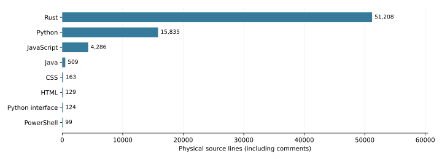
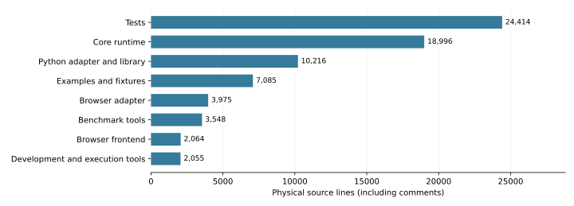
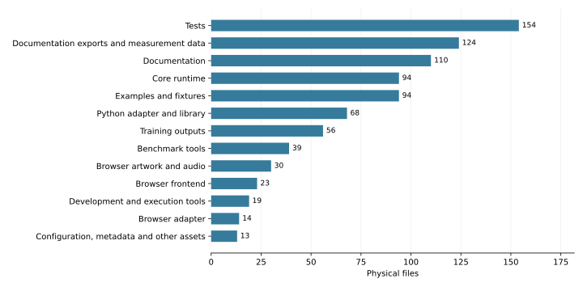

# Framework size and tests

Refreshed after the state/history refactors and benchmark consolidation.
This census describes the saved working checkout on 26 October 2026 and a
public-scope projection. The projection is a precise counting inventory, not an
approved release or a published repository. A final release needs its own recount.

The projection contains **838 files**, including **434 source files with 72,353
physical lines** across implementation, tests, examples and tools. Of these source
lines, 51,208 are Rust, 15,835 Python and 4,286 JavaScript. Markdown, configuration,
recorded data and generated graphics are additional categories, not source code.

The [tables](data/tables.md) separate languages and components. The
[public file manifest](data/manifest.json) records every included path, byte count,
SHA-256 digest and physical line count; [CSV totals](data/summary.csv) support
independent analysis. Working totals include development documentation, while the
public projection omits it. Runtime code is unchanged by this measurement.



These are **physical source lines, including comments**, rather than statements
or executable code. Blank/nonblank totals are available, but no language lexer is
used to distinguish comments. Rust contains the rules, forward models and native
search; Python includes learning code and adapter workflows. Java files here are
comparison tools, not an additional engine implementation.



Each physical file belongs to one component. Separate test files are classified
as tests; tests embedded inside runtime modules remain in their containing file's
line totals. HTML scripts/styles and Markdown code examples are not extracted or
counted twice. File counts do not measure architectural quality.



Documentation, configuration, recorded measurements, graphics and training outputs
are counted separately from source. In particular, saved models/checkpoints are
data. SVG is text markup, while PNG/PDF/audio/checkpoints contribute files and bytes
but no text lines. Existing documentation exports remain visible as generated
deliverables. Census products exclude themselves from measured inputs; their
[separate inventory](data/products.json) lists exports and data, excluding that
inventory file itself. This avoids a self-referential line/hash count.

## Automated tests

| Suite | Unique discovered tests | Executions | Passed | Failed | Skipped/ignored |
|---|---:|---:|---:|---:|---:|
| Rust workspace, all targets and features | 316 | 378 | 378 | 0 | 0 |
| Rust Python adapter | 8 | 8 | 8 | 0 | 0 |
| Rust documentation examples | 1 | 1 | 1 | 0 | 0 |
| Python adapter and learning methods | 205 | 205 | 205 | 0 | 0 |
| JavaScript frontend tests | 73 | 73 | 73 | 0 | 0 |
| Python census/statistics tool tests | 10 | 10 | 10 | 0 | 0 |
| **Total** | **613** | **675** | **675** | **0** | **0** |

[Test identities and execution contexts](data/tests.json) explain the totals.
The extra 62 Rust executions compile shared match/tournament tests into example
binaries; they add no unique tests. Root/library names are kept distinct across
crates. Python counts discovered test methods, including methods that internally
loop over configurations or use `subTest`; those internal cases are not separately
enumerated. JavaScript counts named Node tests, not every assertion. Test counts
say nothing by themselves about behavioural coverage.

Unit-test discovery and execution above were rerun for this refresh. The following
operational results are retained from the earlier census and were not rerun here.
The native match and tournament CLI verification scripts also passed: these are
two operational suites, outside the unit-test total. The graphical Chrome suite
was **unavailable**: its GPU process exited with `-1073741790` before page cases ran.
Consequently no real-browser/actual-Wasm case is claimed as executed here. The Node
tests exercise frontend logic and mocks. Prior manual graphics acceptance is
separate and was not repeated. Java comparison programs contain benchmark
invariants, not a discovered Java unit-test suite.

## Reproduce the inventory

Use the [counter commands and inclusion rules](../../../tools/census/README.md).
The counter is version 1.0, written using Python's standard library; this snapshot
used Python 3.14.8 and Git's tracked/nonignored file inventory. Generated bindings,
builds, virtual environments, caches, vendored dependencies and disposable Java
copies are outside that inventory under the repository ignore rules. It does not
follow symlinks or junctions. A changed ignore policy changes the measured scope.

For figures, install the optional plotting dependency as described in
[setup](../../guides/setup.md), then run from the repository root:

```powershell
python tools/census/plot.py
```

`--data` and `--output` optionally select input/output directories; their defaults
are this report's `data/` and `plots/`. Exports are SVG, PDF and PNG, without visible
titles. Rerun the counter after plotting to refresh the separate product inventory.
The [generated bindings inventory](data/generated-bindings.json) separately records
the locally built Wasm/glue files and compiled Python extension with hashes and
sizes. These are platform/build-dependent deliverables, outside authored-line totals.

For test discovery/execution commands and captured-log aggregation, see the
[test census instructions](../../../tools/census/README.md#test-census).
