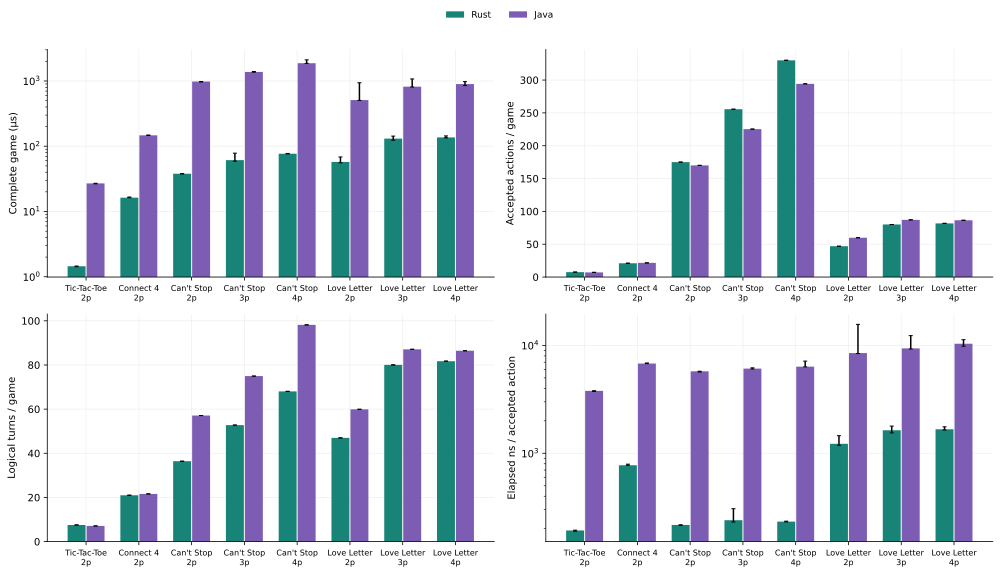
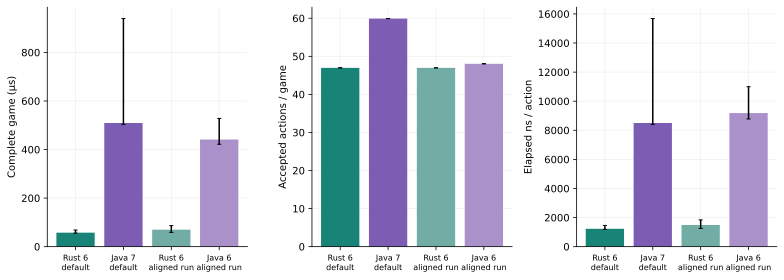
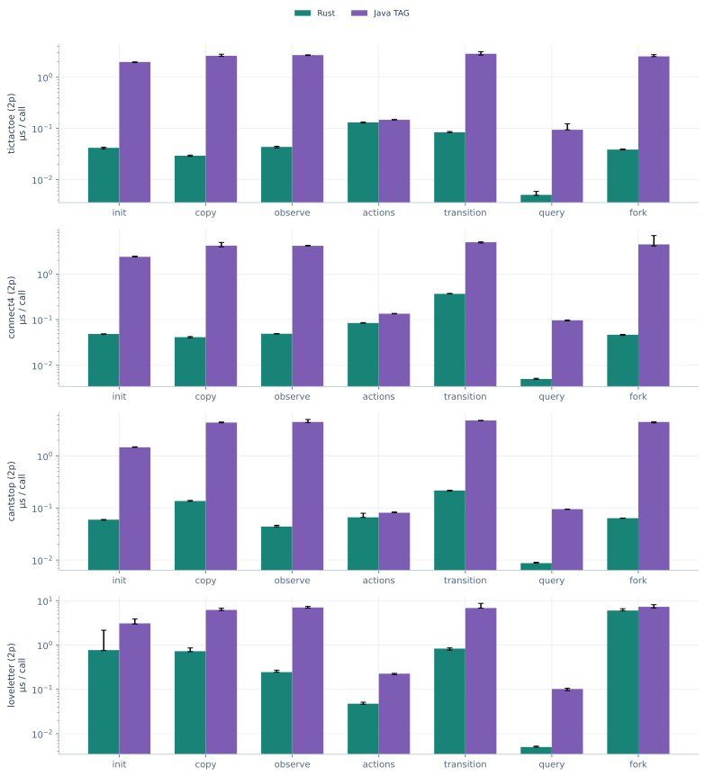
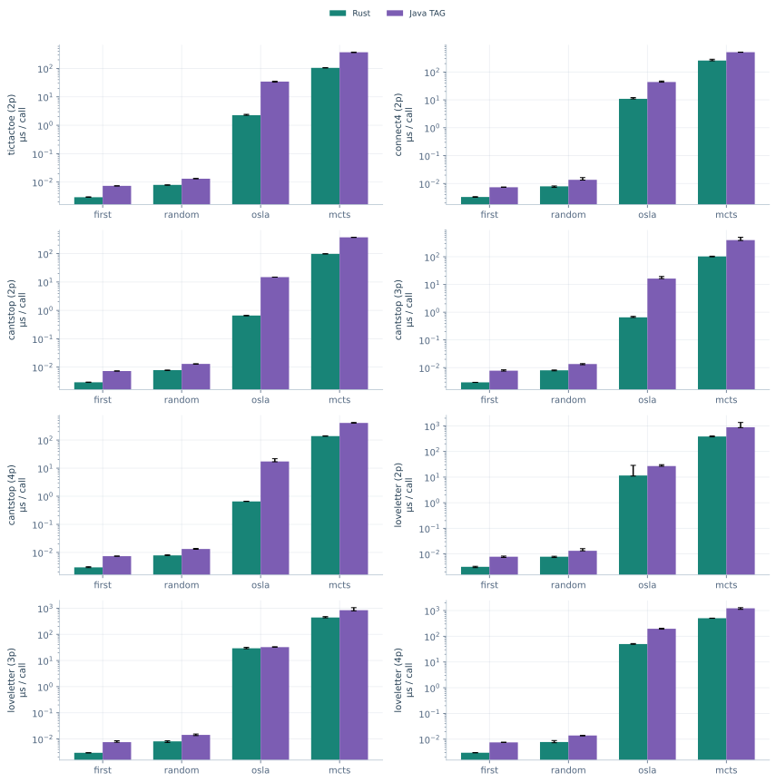
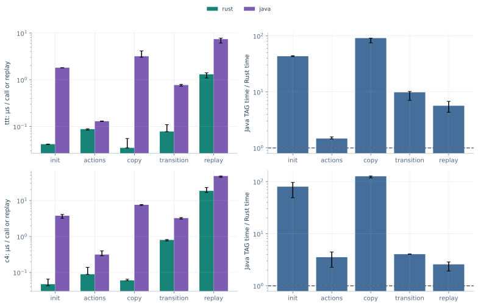
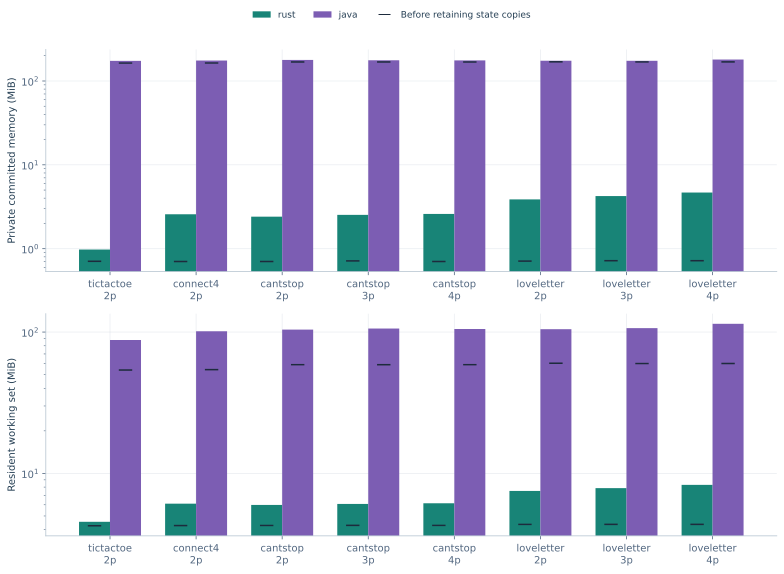
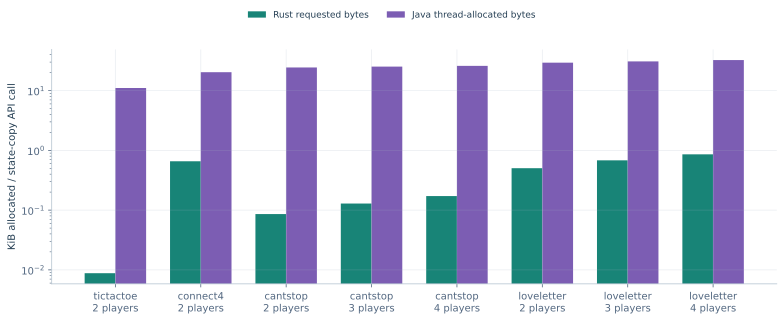

# Updated four-game speed and memory measurements

Fresh measurements on 26 October 2026 use the current Rust implementation and
the warmed, unmodified public Java reference. They include the complete benchmark
suite and additional game-length/per-turn/component diagnostics.

The first column of timing comparisons is **Java time / Rust time**: above 1 means
Rust was faster for the measured operation; below 1 means Rust was slower. Rule,
knowledge and search differences remain part of these implementation comparisons.
[Methodology](methodology.md) defines the included work and limits. Tables report
the median of three independent-process medians, each based on five timed batches.

## Complete Random games with observation handling in both engines

Both implementations generate actions from state, construct the acting player's
observation/player copy, call the actual Random controller, then apply the move.
Blocks cover the same 32 seeded controller fixtures within each engine. These
are complete games, including setup; stochastic histories differ between engines.

| Java/Rust game time | Game | Players | Rust µs/game | Java µs/game | Rust actions/game | Java actions/game | Java/Rust time per action |
|---|---|---|---|---|---|---|---|
| 18.58 | Tic-Tac-Toe | 2 | 1.449 | 26.920 | 7.531 | 7.094 | 19.72 |
| 9.03 | Connect 4 | 2 | 16.272 | 146.893 | 21.000 | 21.594 | 8.78 |
| 25.83 | Can't Stop | 2 | 37.907 | 979.206 | 175.031 | 170.062 | 26.59 |
| 22.44 | Can't Stop | 3 | 61.254 | 1374.391 | 255.562 | 225.281 | 25.45 |
| 24.36 | Can't Stop | 4 | 76.798 | 1870.603 | 330.031 | 294.188 | 27.33 |
| 8.85 | Love Letter | 2 | 57.516 | 509.210 | 46.969 | 59.906 | 6.94 |
| 6.25 | Love Letter | 3 | 130.897 | 817.869 | 80.031 | 87.094 | 5.74 |
| 6.57 | Love Letter | 4 | 136.564 | 896.710 | 81.719 | 86.438 | 6.21 |

A game taking longer does not by itself imply a slower forward model: it may
execute more actions. The last column normalizes by actual accepted actions.
Logical turns include terminal turns; Can't Stop has several actions per turn.
Full per-turn lengths and timings are in [the normalized CSV](game-summary.csv).

## Love Letter with equal winning-token targets

Defaults use six tokens in Rust and seven in two-player Java. This additional
profile configures Java's public winning-token parameter to six; both sides still
construct observations. Other rule/knowledge/RNG differences are retained.

| Java/Rust game time | Game | Players | Rust µs/game | Java µs/game | Rust actions/game | Java actions/game | Java/Rust time per action |
|---|---|---|---|---|---|---|---|
| 6.31 | Love Letter | 2 | 69.908 | 441.078 | 46.969 | 48.031 | 6.17 |

## Rules and prepared-state APIs

Two-player profiles below use each implementation's prepared opening state.
Stochastic positions are not matched; timings are microseconds per call.
Copy-plus-apply includes an input clone; isolated checked transitions are measured
separately in the component probes.

| Java/Rust time | Game | Operation | Rust µs | Java µs |
|---|---|---|---|---|
| 47.59 | Tic-Tac-Toe | Initialize | 0.0417 | 1.9851 |
| 1.13 | Tic-Tac-Toe | Actions | 0.1309 | 0.1474 |
| 89.69 | Tic-Tac-Toe | Copy | 0.0292 | 2.6227 |
| 62.24 | Tic-Tac-Toe | Observation/player copy | 0.0434 | 2.7040 |
| 34.29 | Tic-Tac-Toe | Copy + apply | 0.0838 | 2.8723 |
| 49.02 | Connect 4 | Initialize | 0.0486 | 2.3825 |
| 1.60 | Connect 4 | Actions | 0.0844 | 0.1351 |
| 101.50 | Connect 4 | Copy | 0.0413 | 4.1923 |
| 84.59 | Connect 4 | Observation/player copy | 0.0491 | 4.1531 |
| 13.52 | Connect 4 | Copy + apply | 0.3675 | 4.9693 |
| 24.53 | Can't Stop | Initialize | 0.0597 | 1.4635 |
| 1.23 | Can't Stop | Actions | 0.0662 | 0.0812 |
| 32.07 | Can't Stop | Copy | 0.1364 | 4.3745 |
| 102.01 | Can't Stop | Observation/player copy | 0.0440 | 4.4888 |
| 22.09 | Can't Stop | Copy + apply | 0.2168 | 4.7905 |
| 4.00 | Love Letter | Initialize | 0.7667 | 3.0704 |
| 4.75 | Love Letter | Actions | 0.0475 | 0.2254 |
| 8.53 | Love Letter | Copy | 0.7226 | 6.1612 |
| 28.68 | Love Letter | Observation/player copy | 0.2446 | 7.0152 |
| 8.21 | Love Letter | Copy + apply | 0.8306 | 6.8174 |

## Agent decisions

These are prepared-root decision costs, not playing-strength comparisons or
complete matches. OSLA and MCTS perform different internal work across the two
implementations. MCTS uses 32 iterations and rollout limit four. First Available
uses Rust's agent and Java's first-list-element baseline; such tiny measurements
can be dominated by harness/dispatch costs. Root preparation and controller setup
are included or excluded as specified in the methodology and workload manifest.

| Java/Rust time | Game | Agent/operation | Rust µs | Java µs |
|---|---|---|---|---|
| 2.51 | Tic-Tac-Toe | First Available / list baseline | 0.0029 | 0.0074 |
| 1.65 | Tic-Tac-Toe | Random | 0.0079 | 0.0131 |
| 15.23 | Tic-Tac-Toe | OSLA | 2.2540 | 34.3241 |
| 3.54 | Tic-Tac-Toe | MCTS | 104.2131 | 369.2259 |
| 2.23 | Connect 4 | First Available / list baseline | 0.0033 | 0.0073 |
| 1.71 | Connect 4 | Random | 0.0079 | 0.0135 |
| 4.01 | Connect 4 | OSLA | 10.8564 | 43.5664 |
| 1.99 | Connect 4 | MCTS | 256.8872 | 510.7525 |
| 2.50 | Can't Stop | First Available / list baseline | 0.0029 | 0.0073 |
| 1.65 | Can't Stop | Random | 0.0078 | 0.0130 |
| 22.59 | Can't Stop | OSLA | 0.6596 | 14.9013 |
| 3.84 | Can't Stop | MCTS | 97.8108 | 376.0688 |
| 2.49 | Love Letter | First Available / list baseline | 0.0031 | 0.0078 |
| 1.70 | Love Letter | Random | 0.0078 | 0.0132 |
| 2.34 | Love Letter | OSLA | 11.5325 | 27.0208 |
| 2.29 | Love Letter | MCTS | 386.5371 | 886.2758 |

## Matched placement-game replay corpus

This is the strongest equal-work comparison: both engines replay the same 32
validated histories per game and check boards, outcomes and available choices.
Replay values are per complete game; other operations are per call.

| Java/Rust time | Game | Operation | Rust µs | Java µs |
|---|---|---|---|---|
| 43.30 | Tic-Tac-Toe | Initialize | 0.0419 | 1.8130 |
| 1.47 | Tic-Tac-Toe | Actions | 0.0881 | 0.1295 |
| 91.01 | Tic-Tac-Toe | Copy | 0.0350 | 3.1865 |
| 9.84 | Tic-Tac-Toe | Apply | 0.0783 | 0.7706 |
| 5.66 | Tic-Tac-Toe | Complete replay | 1.3082 | 7.4019 |
| 80.06 | Connect 4 | Initialize | 0.0471 | 3.7744 |
| 3.54 | Connect 4 | Actions | 0.0888 | 0.3140 |
| 126.44 | Connect 4 | Copy | 0.0601 | 7.5939 |
| 4.05 | Connect 4 | Apply | 0.8002 | 3.2409 |
| 2.58 | Connect 4 | Complete replay | 18.5739 | 47.9450 |

Java full copies include component maps, timers, history bookkeeping and branched
RNGs; Rust uses compact game-specific values. Ratios include those architectural
choices, rather than isolating the programming language.

## Memory, adapters and complete workflows

All earlier memory/adapter categories were recollected. Process committed memory,
resident working set, post-GC Java heap and requested allocation bytes describe
different quantities; initialized runtime/scaffolding must be separated from the
additional retained game states. JVM baseline memory is not per-state resident RAM.

The [diagnostic details](details.md) include per-turn normalization, direct-choice
controls, state/history copying, aligned token targets, Python/neural batches,
feature/tree memory, histories/branches, learner collection and CLI results.
[All figures](plots/README.md) are reusable SVG/PDF/PNG exports without visible titles.
The [data/reproduction index](data.md), [environment](environment.json),
[source hashes](source-hashes.json) and [class hashes](java-class-hashes.json)
identify the measured working code and reference. No global language multiplier
is inferred from these fixtures.

## Requested allocation volume

These are bytes requested per full-state copy, measured separately from latency.
Rust values exclude inline state storage; Java values count current-thread allocations.
They are not retained or resident bytes per state.

| Java/Rust requested bytes | Game | Players | Rust bytes/copy | Java bytes/copy |
|---|---|---|---|---|
| 1257.78 | Tic-Tac-Toe | 2 | 9.0 | 11320.0 |
| 31.01 | Connect 4 | 2 | 672.0 | 20840.0 |
| 283.91 | Can't Stop | 2 | 88.0 | 24984.0 |
| 195.94 | Can't Stop | 3 | 132.0 | 25864.0 |
| 151.27 | Can't Stop | 4 | 176.0 | 26624.0 |
| 58.50 | Love Letter | 2 | 515.0 | 30128.0 |
| 45.29 | Love Letter | 3 | 697.0 | 31568.0 |
| 37.82 | Love Letter | 4 | 879.0 | 33240.0 |
