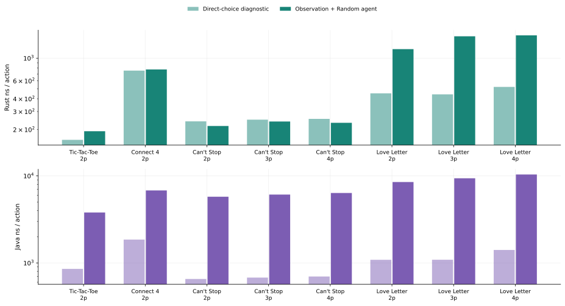
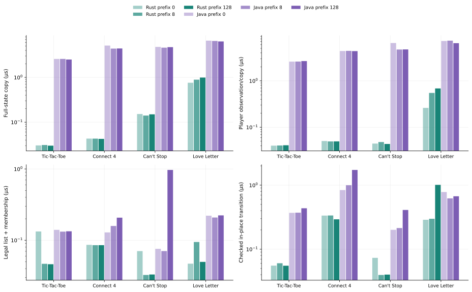
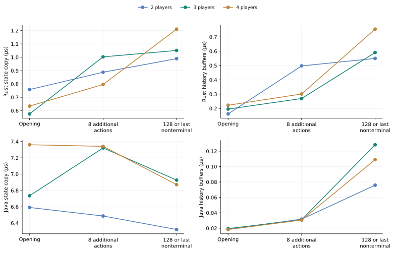
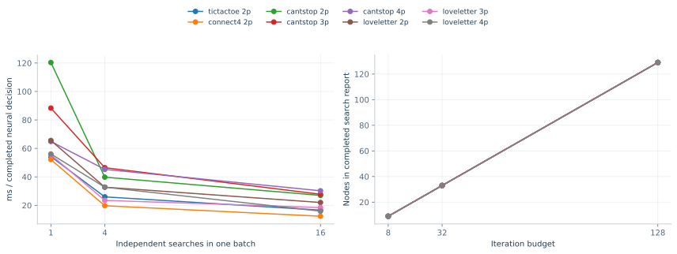
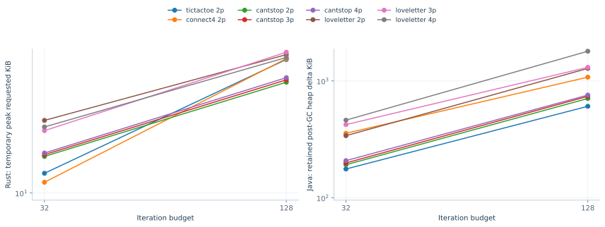
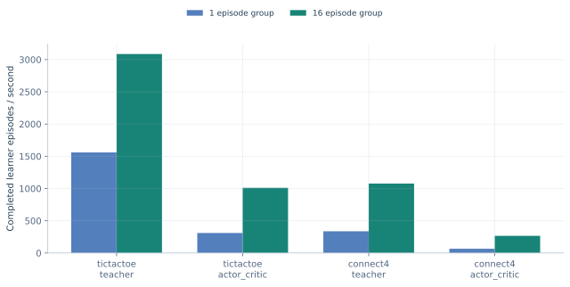
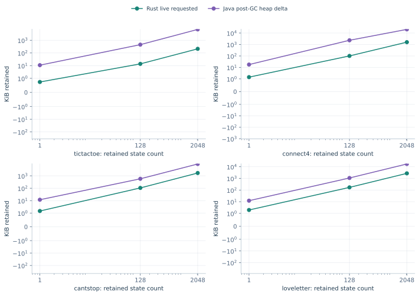
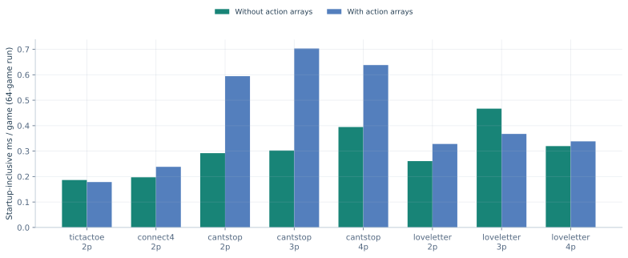
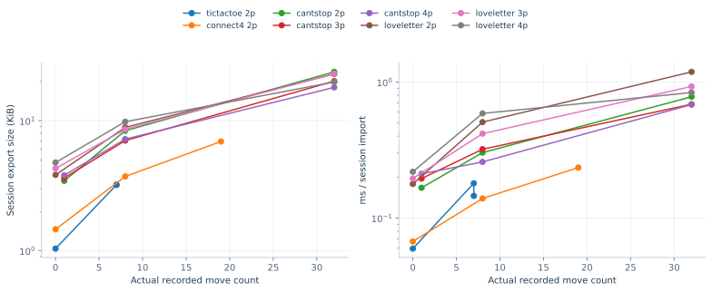
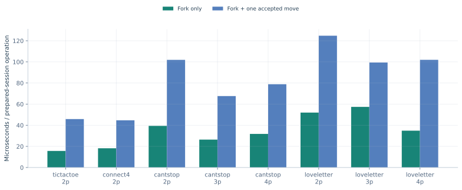

# Workflow and component diagnostics

See [measurement scope](methodology.md) before comparing these costs. Full-game
elapsed time includes setup and final state disposal/GC; normalization uses actual
measured work, not assumed or warmup-inclusive lengths. Logical turns include
terminal plays, with one bank/bust turn spanning multiple actions in Can't Stop.

## Game lengths and per-turn costs

| Java/Rust per turn | Game | Players | Rust turns/game | Java turns/game | Rust µs/turn | Java µs/turn | Rust rounds/game | Java rounds/game |
|---|---|---|---|---|---|---|---|---|
| 19.72 | Tic-Tac-Toe | 2 | 7.531 | 7.094 | 0.192 | 3.795 | — | — |
| 8.78 | Connect 4 | 2 | 21.000 | 21.594 | 0.775 | 6.803 | — | — |
| 16.47 | Can't Stop | 2 | 36.406 | 57.094 | 1.041 | 17.151 | — | — |
| 15.79 | Can't Stop | 3 | 52.750 | 74.969 | 1.161 | 18.333 | — | — |
| 16.88 | Can't Stop | 4 | 68.031 | 98.156 | 1.129 | 19.057 | — | — |
| 6.94 | Love Letter | 2 | 46.969 | 59.906 | 1.225 | 8.500 | 9.062 | 11.406 |
| 5.74 | Love Letter | 3 | 80.031 | 87.094 | 1.636 | 9.391 | 10.062 | 9.906 |
| 6.21 | Love Letter | 4 | 81.719 | 86.438 | 1.671 | 10.374 | 8.844 | 9.000 |

Only Love Letter has the card-game rounds counted here. Raw board framework
round counters remain available in the data but are not presented as game rounds.

## Observation construction versus direct choice

Both paths use the same within-engine seeded fixture cycle and forced-choice RNG
convention. The diagnostic path omits observation construction and the actual
agent wrapper; it is not the ordinary uniform agent interface. Values are µs/game.

| Java/Rust direct time | Game | Players | Rust direct µs | Java direct µs | Rust full/direct | Java full/direct |
|---|---|---|---|---|---|---|
| 5.07 | Tic-Tac-Toe | 2 | 1.194 | 6.054 | 1.21 | 4.45 |
| 2.52 | Connect 4 | 2 | 15.856 | 40.027 | 1.03 | 3.67 |
| 2.64 | Can't Stop | 2 | 42.086 | 111.150 | 0.90 | 8.81 |
| 2.39 | Can't Stop | 3 | 63.827 | 152.750 | 0.96 | 9.00 |
| 2.45 | Can't Stop | 4 | 83.921 | 205.366 | 0.92 | 9.11 |
| 3.06 | Love Letter | 2 | 21.227 | 65.035 | 2.71 | 7.83 |
| 2.68 | Love Letter | 3 | 35.372 | 94.693 | 3.70 | 8.64 |
| 2.85 | Love Letter | 4 | 42.722 | 121.722 | 3.20 | 7.37 |

Full/direct ratios compare independent process groups collected at different
times. Rust's Can't Stop ratios below one illustrate measurement/code-path
variation; they do not establish that constructing a view has negative cost.
Likewise, the Rust six-token profile is repeated independently from its identical
default configuration. Use process ranges rather than treating small differences
between these runs as causal effects.

## Prepared-position components

Fixtures advance up to 0, 8 or 128 additional actions and stop before terminal
play. Actual lengths are stored per engine/fork in the component JSON/CSV.
Below are the late/capped positions. `validate` re-enumerates legal actions and
checks membership; `apply` includes all checked rule effects, with input copies
prepared outside the timer. These are position-specific probes, not additive
components that sum exactly to mean whole-game latency.

| Java/Rust time | Game | Players | Operation | Rust µs | Java µs |
|---|---|---|---|---|---|
| 83.43 | Tic-Tac-Toe | 2 | copy | 0.0299 | 2.4988 |
| 64.98 | Tic-Tac-Toe | 2 | observe | 0.0409 | 2.6595 |
| 2.90 | Tic-Tac-Toe | 2 | validate | 0.0461 | 0.1335 |
| 7.88 | Tic-Tac-Toe | 2 | apply | 0.0553 | 0.4359 |
| 103.89 | Connect 4 | 2 | copy | 0.0424 | 4.4096 |
| 87.92 | Connect 4 | 2 | observe | 0.0496 | 4.3650 |
| 2.43 | Connect 4 | 2 | validate | 0.0853 | 0.2074 |
| 5.90 | Connect 4 | 2 | apply | 0.2928 | 1.7265 |
| 31.56 | Can't Stop | 2 | copy | 0.1497 | 4.7240 |
| 108.51 | Can't Stop | 2 | observe | 0.0437 | 4.7412 |
| 29.27 | Can't Stop | 2 | validate | 0.0331 | 0.9681 |
| 10.21 | Can't Stop | 2 | apply | 0.0402 | 0.4101 |
| 43.16 | Can't Stop | 3 | copy | 0.1421 | 6.1346 |
| 113.24 | Can't Stop | 3 | observe | 0.0485 | 5.4932 |
| 22.84 | Can't Stop | 3 | validate | 0.0338 | 0.7722 |
| 11.85 | Can't Stop | 3 | apply | 0.0403 | 0.4776 |
| 36.52 | Can't Stop | 4 | copy | 0.1462 | 5.3392 |
| 128.25 | Can't Stop | 4 | observe | 0.0466 | 5.9749 |
| 19.73 | Can't Stop | 4 | validate | 0.0320 | 0.6304 |
| 15.35 | Can't Stop | 4 | apply | 0.0402 | 0.6171 |
| 6.39 | Love Letter | 2 | copy | 0.9896 | 6.3208 |
| 9.44 | Love Letter | 2 | observe | 0.6849 | 6.4637 |
| 4.49 | Love Letter | 2 | validate | 0.0497 | 0.2231 |
| 0.66 | Love Letter | 2 | apply | 1.0108 | 0.6706 |
| 6.59 | Love Letter | 3 | copy | 1.0510 | 6.9269 |
| 10.85 | Love Letter | 3 | observe | 0.6552 | 7.1107 |
| 16.96 | Love Letter | 3 | validate | 0.0479 | 0.8124 |
| 3.36 | Love Letter | 3 | apply | 0.3108 | 1.0459 |
| 5.68 | Love Letter | 4 | copy | 1.2103 | 6.8712 |
| 9.56 | Love Letter | 4 | observe | 0.7508 | 7.1743 |
| 24.55 | Love Letter | 4 | validate | 0.0498 | 1.2224 |
| 1.05 | Love Letter | 4 | apply | 1.1290 | 1.1855 |

At the capped two-player Love Letter position, Rust's checked transition is
slower than Java's. These states and their automatic consequences are not matched;
this result is retained rather than generalizing the whole-game advantage to
every transition. The CSV includes the actual preparation lengths.

Love Letter's history probe copies retained current/previous-round public/private
event buffers in Rust and action/text history lists in Java. Their contents and
deep/shallow-copy semantics differ. Current Rust state has no match-long proof;
round resets can make a later position smaller than an earlier one.

Opening `apply_control` measures the clock/loop floor over 1000 prepared blocks.
Its values are retained in component summaries and are never subtracted.
The [component CSV](component-summary.csv) includes all prefixes, save/load costs,
actual prepared lengths and process ranges; [JSON](component-summary.json) retains
per-process fixture metadata. Separate allocation probes use the same modes.

## Python, local models, episodes and memory

CPU fixtures use deterministic untrained networks with one 16-unit hidden layer.
They measure execution cost, not agent strength. Neural MCTS uses full player-value
vectors; scalar discounted OSLA has a separate contract. Independent-tree/model
batches and actual seat/root mixtures remain distinct workload dimensions.

Learner-step collection here covers the registered Tic-Tac-Toe/Connect 4 workflows;
neural search/model probes cover all eight game/player profiles. Native browser
adapter timings cover host Rust/JSON and local inference, including Q-table,
OSLA/MCTS policies, saved history, branches and continuation. They do not include
Web Worker transport or rendering. Search/memory counters describe algorithmic
work and must not be substituted for physical allocation measurements.

All raw observations, optional-feature footprints and initialized baselines remain
in the [data index](data.md). Requested bytes, Java heap, committed process memory
and resident memory have the separate meanings defined in the methodology.

## Retained knowledge and persistence costs

Two-player Rust probes below use opening and later/capped positions.
All values are microseconds per call; history copying measures retained knowledge
containers separately, while full copy includes them. These medians overlap in
included work and must not be added together. Save/load is outside the search
transition path.

| Operation | Opening | Up to 8 actions | Up to 128 actions |
|---|---|---|---|
| copy | 0.7583 | 0.8881 | 0.9896 |
| history_copy | 0.1616 | 0.4975 | 0.5496 |
| observe | 0.2611 | 0.5483 | 0.6849 |
| validate | 0.0469 | 0.0946 | 0.0497 |
| apply | 0.2881 | 0.2985 | 1.0108 |
| save | 1.9533 | 5.1328 | 6.6755 |
| load | 9.8506 | 32.9610 | 42.4419 |

The complete-snapshot save format preserves current facts and exact RNG continuation.
Its validation/serialization can cost more than the earlier opening-state proof
recipe. It avoids replay proportional to the whole earlier match; it does not
promise cheaper saves at every position. Retained knowledge still varies by round.
