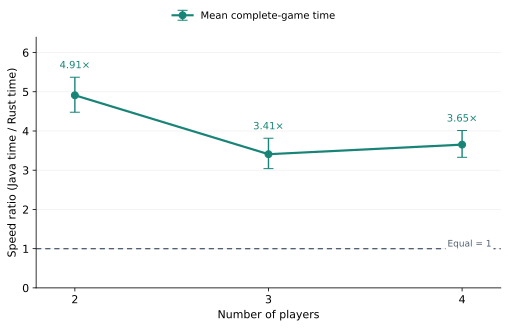
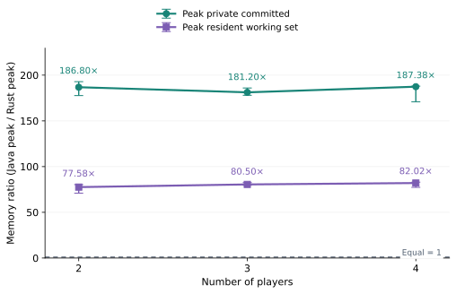
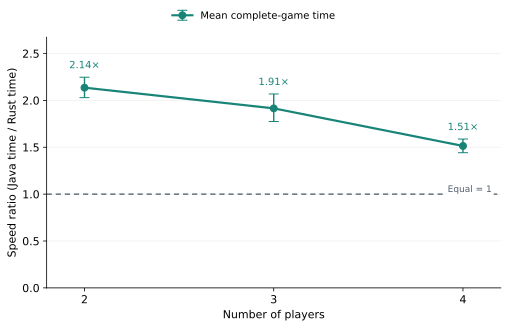
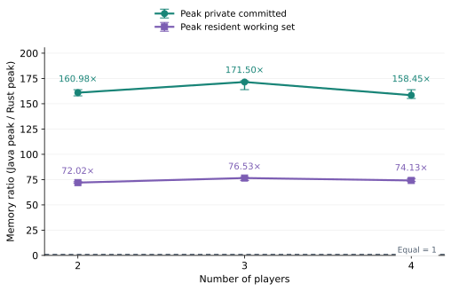
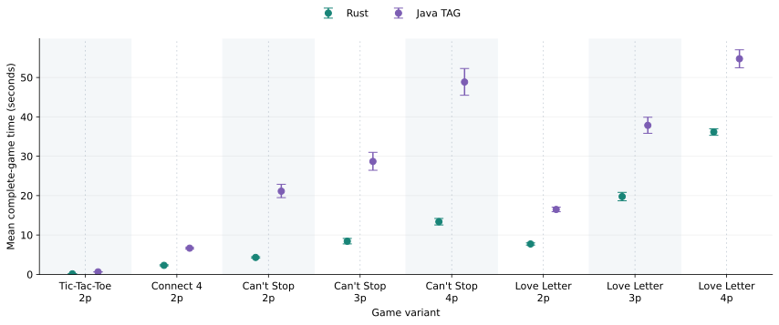
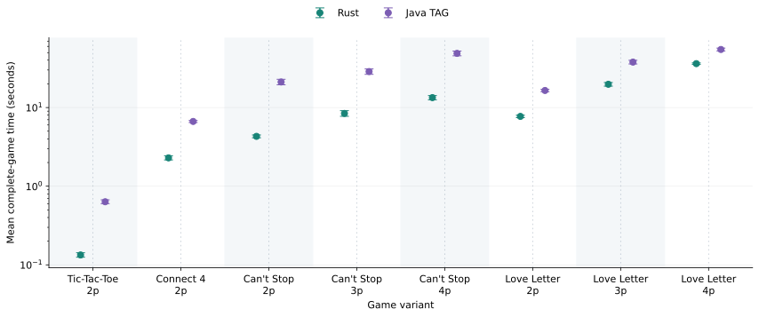
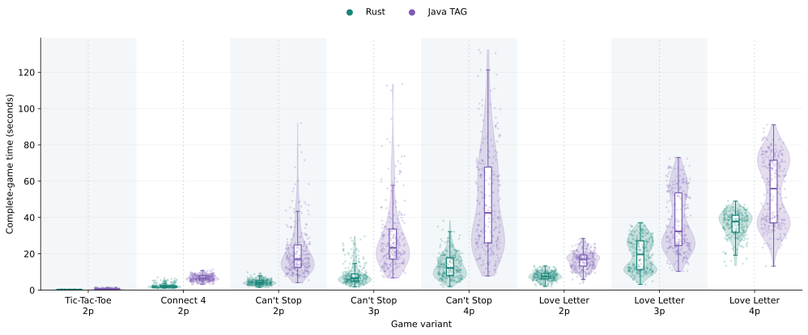
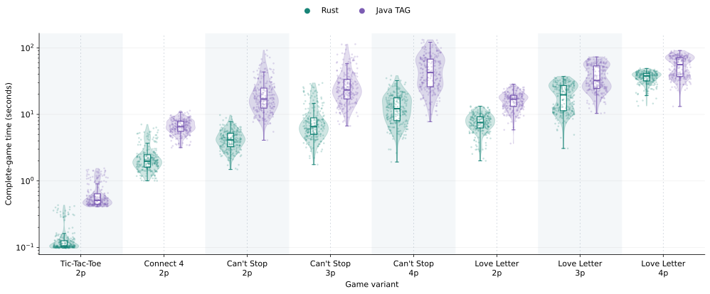

# Ratios by player count

Every ratio is **Java / Rust**: 1 means equal, and values above 1 mean Rust
uses less time or memory. Speed uses pooled mean complete-game time, including
instrumentation; differences in game length, heuristics and search work remain.
Memory uses the ratio of median sampled process peaks, separately for private
committed memory and resident working set. These include runtime and search
memory, and are not sizes of individual states. Baselines are not subtracted.
Lines connect the measured player counts; they are not fitted predictions.

There are 250 included games per setting except Java Love Letter with three
players, which has 248 after the two approved exclusions. No additional games
were excluded. [Underlying ratios and values](ratios.csv) retain full precision.
See the [study report](../../README.md) for settings and limitations.

Error bars are **95% percentile bootstrap confidence intervals**, using 20,000
resamples and fixed seed 20261030. For time, resample complete included games
independently within each engine/profile and recompute the pooled mean. For
ratios, divide independently resampled Java estimates by Rust estimates; matching
seeds do not imply paired trajectories. These time intervals describe variation
among games conditional on the measured processes; they do not include all
between-process or between-machine timing uncertainty. They are intervals for
the estimated mean, not the range in which 95% of individual games finish.

For memory, resample whole measured processes and recompute each engine's median
peak before taking the ratio. There are only three measured processes per
engine/profile, so these intervals have limited resolution and cannot establish
precise memory uncertainty. They cover variation in sampled peaks, not memory
spikes missed by the 50 ms sampler. No new benchmark measurements were taken.

## Can't Stop

[PNG](cantstop-speed.png) · [PDF](cantstop-speed.pdf) · [SVG](cantstop-speed.svg)

[PNG](cantstop-memory.png) · [PDF](cantstop-memory.pdf) · [SVG](cantstop-memory.svg)

## Love Letter

[PNG](loveletter-speed.png) · [PDF](loveletter-speed.pdf) · [SVG](loveletter-speed.svg)

[PNG](loveletter-memory.png) · [PDF](loveletter-memory.pdf) · [SVG](loveletter-memory.svg)

## Complete-game time across all variants

Points show the mean for each engine, with 95% confidence intervals.
The second version uses a logarithmic y-axis so the shorter games remain visible.
[Means, counts and confidence limits](times.csv) give the numerical values.

[PNG](all-games-time-linear.png) · [PDF](all-games-time-linear.pdf) · [SVG](all-games-time-linear.svg)

[PNG](all-games-time-log.png) · [PDF](all-games-time-log.pdf) · [SVG](all-games-time-log.svg)

## Distribution of individual game times

Every included game appears as a small dot: 3,998 observations across all
engine/variant combinations. Horizontal jitter separates overlapping dots and
has no numerical meaning. Each tinted violin shows a smoothed distribution;
width indicates relative density within that engine/variant, not sample count.
The small box spans the middle 50% of game times, with a line at the median.
Whiskers extend to the most extreme observations within 1.5 box heights of the
box. All observations beyond the whiskers remain visible as dots.

The logarithmic version makes the shorter games visible. Its violin density is
estimated in log-time; its boxes and whiskers retain their definitions in seconds.
These distributions show variation between individual games; the confidence bars
in the preceding plots describe uncertainty in the estimated means instead.
Vertical guides and alternating bands associate both engines with each variant.
[Individual times with game IDs and seeds](individual-game-times.csv) reproduce
the plotted observations. The same two approved exclusions remain in effect.

[PNG](all-games-distribution-linear.png) · [PDF](all-games-distribution-linear.pdf) · [SVG](all-games-distribution-linear.svg)

[PNG](all-games-distribution-log.png) · [PDF](all-games-distribution-log.pdf) · [SVG](all-games-distribution-log.svg)
