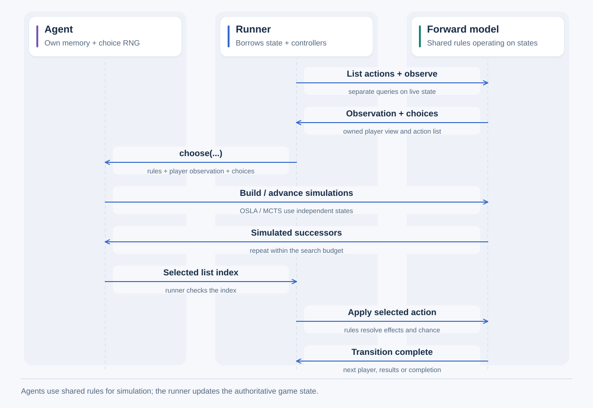

# Add a new agent to the framework

For operating instructions, use the [short manual](../../guides/agents/new-agent.md). This page contains
the detailed reference.

Updated 15-10-2026. An **agent** chooses moves for a player. This guide follows
[RandomAgent](../../../src/agents/random.rs), which selects an available action at random.
It covers a command-line match, mixed human/AI play, recordings, files and the browser.
The [project introduction](../../start-here.md) explains the game/agent terms; the
[Rust guide](../framework/rust-for-java-cpp.md) explains references, traits, enums and Result.

The current native agents are First Available, Random, OSLA, OSLAPython and
[MCTS](mcts-api.md). Browser registration is a separate integration step.
OSLAPython implements the common Agent interface plus PreparedEvaluationAgent for
external batches. Its [guide](../python/external-osla.md) explains native backends and
the Rust/Python prepare/finish/commit flow. Its current integration covers native
execution and Python; browser/replay-file registration requires a separate design
for servicing its external evaluator. The workflow below covers the existing
fully registered browser policies.

## One native decision



Time runs downward. The [runner](../../../src/runner.rs) temporarily borrows
state and controllers from its caller; each agent retains its own RNG and memory.
In C++ terms, a shared Rust borrow resembles `const State&`, while an exclusive
borrow resembles `State&` with compiler-enforced exclusive access. An agent receives
the shared forward model (`&F`), an observation and choices. OSLA and MCTS use
that forward model to construct and advance independent simulation states, using
planning randomness where needed. The authoritative state stays with the caller;
the runner applies the selected action to it. The simulation arrows show work
inside `choose()`; agents such as Random can choose without simulating.

## 1. Implement the common agent interface

All agents implement `Agent<F>`, receive the same inputs, and own a separate
random-number generator (RNG). Here `F` is the game model type. `F::Action` means
that game's action type, selected by its ForwardModel implementation.

The runner calls `choose()` with:

Before that call, the runner obtains the ordered actions directly from state with
`available_actions(state, actor)` and separately constructs the player's observation
with `observe(state, actor)`. This is the same procedure for every agent, including
Random and First Available. Action generation uses only facts the acting player
may know; a full state remains inside the trusted runner. Observation-based
`offered_actions(observation)` supports search and APIs that already hold a view,
using the same game rules and action order.

| Input | Meaning |
|---|---|
| `&mut self` | Access to the agent being asked. It can update its own memory and RNG. Rust prevents other accesses during that mutable borrow. |
| `&F` | Read-only access to the game rules and queries. |
| `PlayerId` | The seat that is choosing: for example Player 0. |
| `&F::Observation` | Read-only access to information that player is allowed to know. |
| `&[F::Action]` | A read-only view of the ordered list of actions to choose from. |

`choose()` returns `Result<usize, Self::Error>`: either an index into that list or
an error explaining why the agent could not choose. For `[drop_in_2, drop_in_5]`,
returning 1 selects column 5. The index identifies a position in this particular
list. The learning interface defines separate permanent action IDs for a
neural network; see the [learning-input guide](../learning/overview.md).

Random receives the observation even though it does not use it. Tic-Tac-Toe and
Connect 4 have public boards, so their observations include the full public board.
A hidden-information game must omit facts the player cannot see. Never give an
ordinary agent the true hidden simulation state as a shortcut. For planned search
in hidden games, a sampled possible state represents one hypothesis consistent
with what the player knows.
See the [information contracts](../framework/contracts.md#observations-and-hypothetical-states).

The browser separately constructs observations for displaying a player's view.
Those rendered views and privileged display settings are not agent input. A human
action submission can validate state-derived choices without constructing another
observation.

The function's input references are temporary: the agent may read them while
choosing but cannot retain them afterward. Any memory it keeps must have its own
storage containing only information the player may remember. A forced pass must
be an explicit action. An empty list must be handled according to the decision
API's documented error or completion behavior.

## 2. Implement the policy and its complete configuration

Create `src/agents/<agent>.rs`, then register the module and publicly export its
type in [agents/mod.rs](../../../src/agents/mod.rs). Keep rule changes out of the agent.
List the capabilities it actually needs. Random needs only ForwardModel. OSLA also
needs to reconstruct a simulation state from a public observation and evaluate it.
Do not require a simple agent to implement those extra capabilities unnecessarily.

A **policy** is the rule used to choose actions. Its configuration includes every
setting that can change a choice: a seed, search limit, exploration constant,
evaluator settings or model weights/version. Give settings defaults and validation.
Decide whether changing them restarts the agent at the current position.

Each agent owns `AgentRng` and implements `rng()`/`rng_mut()` to expose shared or
exclusive access to its own generator. Do not put a shared RNG in the runner,
frontend or a global variable. Use the [random module](../../../src/core/random.rs):
its algorithm/version and rules for restoring generator progress are already defined.
An agent's randomness is separate from a game's dice or shuffled decks.

Random and OSLA constructors take a seed explicitly. MCTS also accepts an
automatic seed from operating-system randomness and records the chosen integer.
The existing browser seed controls generate editable defaults from current time. Large seeds are decimal
strings in JSON because JavaScript Number cannot represent every 64-bit integer.
A saved seed restarts a sequence; it does not identify how far an agent has used it.

Random calls `AgentRng::index(actions.len())`. The helper gives equal probability
to each entry, using rejection sampling to avoid rounding bias. An empty list returns
EmptyActionList before drawing; a single choice returns index zero without drawing.
For larger lists, rejection may consume extra RNG outputs. Do not assume one RNG
output per move. Outside a game call, an explicitly qualified Rust method may be
needed: `<RandomAgent as Agent<MyModel>>::rng(&agent)`. Checkpoint::snapshot is
independent of a particular game and is often simpler for inspecting RNG progress.

## 3. Add exact checkpoints for recording and interactive control

A **checkpoint** is saved agent data sufficient to reproduce its future decisions.
Implement [Checkpoint](../../../src/core/checkpoint.rs) for history, prepared moves,
branches and files. Agent alone can run a basic match; full integration needs both.

`snapshot()` reads the agent and returns data with its own storage. `from_snapshot()`
validates that data and creates a separate agent without advancing the original.
Include all settings, memory and RNG progress that affect future choices. Random
needs AgentRngSnapshot; OSLA also saves its evaluator. A learned agent also needs its model identity, relevant configuration and
random-number-generator progress.

A cache can be omitted only if rebuilding it leaves choices unchanged. The native
MCTS implementation rebuilds the search tree for each move; evaluator state and
RNG progress are saved in its snapshot. Neural model loading is implemented in
Python and the optional Rust inference module.

Rust's `#[derive(Clone)]` generates a method that calls `clone()` on each field.
Each field's type determines whether that operation copies its data or shares
an allocation. For checkpoints, choose field representations that preserve the
required independence, then test it. `Debug` supports inspection; `PartialEq`/`Eq`
support comparison. Explain why each is useful and test independence and restoration.
Document nontrivial functions' named arguments, ownership, returned values and errors.

## 4. Integrate native runners and mixed interactive seats

[run_game / run_game_recorded](../../../src/runner.rs) already call Agent<F> without
checking which policy it is. Their agent collection contains one Rust type per run.
An array of RandomAgent values is sufficient for Random versus Random:

```powershell
cargo run --offline --example random
```

For different built-in policies in the same game, update
[session/controllers.rs](../../../src/session/controllers.rs):

| Type/method | Required change |
|---|---|
| BuiltinAgent<E> | Add an enum variant containing the new agent. An enum records which kind of agent is stored. |
| Agent implementation | Forward choose/rng/rng_mut to that variant, preserving the common inputs. |
| BuiltinAgentError | Retain the new agent's error and explain it in Display/source. |
| BuiltinAgentSnapshot | Add the complete checkpoint with its agent-kind label. |
| BuiltinRestoreError / Checkpoint | Recreate that agent kind and report restoration errors. |
| Controller constructor | Add a convenient factory, such as Controller::random(seed). |

Because BuiltinAgent can contain OSLA, its current generic implementation also
requires OSLA's public-information/evaluator capabilities. RandomAgent used alone
does not. The browser uses separate controller enums for stochastic/private
games; new controller families should declare their own capability bounds.

Direct `run_game` and plain Session::advance_ai operate on the live agent. If
choosing fails, the agent may retain memory changes made before failure.
RecordedSession's prepared-move path instead works on a restored temporary agent.
Discarding the temporary result leaves live RNG unchanged. Committing means checking
that the game/agent still match, then applying the move and installing the temporary
agent's progress. RecordedSession::advance_ai uses that prepared path too.

Test both seats, restored positions, nested branches, Reset and controller changes.
If settings are preserved, future random choices must stay the same. A replacement
policy or seed starts a new agent at that position. A branch may begin in moves
inherited from a parent branch; test that case as well as its locally recorded moves.

## 5. Integrate portable files and compatibility

A state-only file contains no agents: its loader chooses fresh controllers.
A replay contains agent kinds, settings and progress so play can continue exactly.
The [persistence guide](../persistence/recordings.md) explains these formats.

Update [replay/format.rs](../../../src/replay/format.rs) and
[replay/controllers.rs](../../../src/replay/controllers.rs). Add a file label for the
new policy and conversions for its entire checkpoint. RngData is sufficient for
Random because its future choices depend entirely on its random-number generator.
For each new policy, list its additional settings and memory and include them
in the checkpoint.

Update [replay_file.rs](../../../src/replay/replay_file.rs) to validate compatibility
and replacement agents. Agent records can occur at a branch start, at a recorded
controller change, or after an accepted move. Inspect all of them when deciding
which file version is required. Loading replays verifies recorded actions, results
and agent progress. Unchanged controllers retain their progress; replacements must
start at their entered seed.

`versions.agents` identifies how agent data in the file is represented and restored.
Version 1 supports the earlier policies; version 2 adds Random. Existing-policy-only
files still use 1. A Random record labelled version 1 is rejected. This version is
separate from game-rule, RNG and overall replay-format versions. Replay format 2
adds controller changes along one line; format 1 without those events remains supported.

Maintainers assign version numbers when they decide whether saved data remains
compatible with the current implementation.
A refactor that leaves choices and saved data unchanged may keep the same version.
A change that affects choices needs an explicit policy for old saves. Do not silently
substitute another agent, and reject bad files before replacing the active session.
There is no moves-only recovery for unsupported agents. Equal Java/Rust seeds alone
do not prove equal decisions or compatibility across arbitrary versions/platforms.

## 6. Register browser configuration, identity and controls

The policy runs in Rust/WebAssembly. JavaScript arranges requests and displays results;
it does not reproduce the agent algorithm or hold the agent's RNG.

| File/function | What to add or review |
|---|---|
| [protocol.rs: SeatSetup](../../../adapters/browser/src/protocol.rs) | Agent-kind label and complete settings received from setup/fork/load forms. |
| [games.rs: builtin_controller / builtin_settings](../../../adapters/browser/src/games.rs) | Create the agent from settings and describe it to the UI. |
| BrowserGame | Only the extra game capabilities the agent really needs. |
| [runtime.rs](../../../adapters/browser/src/runtime.rs), [history.rs](../../../adapters/browser/src/runtime/history.rs), [files.rs](../../../adapters/browser/src/runtime/files.rs) | Check creation, replacement, loading and any justified resource limits. |
| [seat-fields.js](../../../web/seat-fields.js) | Controller dropdown, readable name and shared configuration fields. |
| [setup.js](../../../web/setup.js) / readControllers | Validate settings; keep large seeds exact instead of converting them to Number. |
| [app.js](../../../web/app.js), [files.js](../../../web/files.js) | Compare complete configurations when deciding whether a fork preserves or replaces an agent. |
| [presentation.html](../../../web/presentation.html) | Keep preview labels consistent; this mock setup does not run agents. |

Random supports the full 4,096-cell browser limit; OSLA is limited to 256 cells
because it simulates each available move. New Human/AI games enable automatic AI
responses. AI-only games, Reset, forks and loaded files start paused. Verify Play,
step, delay, cancellation and animation with the new agent. Adding its dropdown
entry alone does not integrate its settings, saves or behavior.

## 7. Validate the complete feature surface

- Test legal list selections, fixed-seed repeatability, empty/single choices, untouched
  source state, independent restored agents and RNG progress. Prefer exact seeded
  checks to a statistical test that can occasionally fail by chance.
- Run public-information and hidden-information games with representative settings
  and different controller combinations where the new agent supports them.
  Compare single-step and automatic move sequences, including errors and cancellation.
- Review earlier moves, preserve/replace either controller, fork from inherited moves,
  switch branches and Reset. Browsing must not advance live RNG.
- Save/load all three file scopes, reject malformed/incompatible files and check old
  supported files. Continue after restoration and compare future decisions.
- Generate real native recordings and compare browser actions, every intermediate
  board, counters and results. A compile or mock worker test is not enough.
- Check actual UI labels, seeds, file downloads/uploads, large boards and keyboard focus.

Policy tests belong in tests/core/agents; runner/session tests cover execution.
Browser adapter tests are under adapters/browser/src/tests; JavaScript/Wasm tests
are under web/tests. Extend native_workload.rs and browser-cases.js for comparisons.
See [test organization](../../../tests/README.md) and [browser commands](../../../web/README.md).
Run formatting, Clippy, relevant Rust/Wasm tests and actual-browser checks. Report
checks you could not run. [Python game operations](../python/game-api.md)
and OSLAPython external evaluation are available. For a new scoring function used
by the existing OSLAPython policy, follow [adding an evaluator](../learning/adding-evaluator.md).
A new decision policy still follows this agent workflow. Neural-value OSLA and
[native MCTS](mcts-api.md) are implemented. For neural request batching, use [neural MCTS](../learning/neural-mcts.md).
[Local model bindings](../learning/local-mcts.md) describe native/browser controllers
and persistence; a new policy still requires explicit registration.

## 8. Finish documentation and provenance

Update affected guides, describe supported configurations and add a runnable
example with its validation checks. Keep source
origins in [source notices](../../source-notices.md).

Public TAG's RandomPlayer is the baseline for uniform action selection. Its copy
method draws a new seed and advances the original generator. Rust's agreed
Checkpoint behavior instead restores the exact saved progress independently.
Preserve that distinction; do not claim equal seeds reproduce Java's RNG behavior.

## Optional learned controllers

The [browser learned-player workflow](../browser/learned-controllers.md) uses a separate
BrowserAgent wrapper for existing built-ins and optional learned policies. It
keeps immutable model allocations separate from each seat's mutable RNG. A native
batched evaluator reuses OslaPythonAgent for neural successor values; the Q-table
selects from legal current-action values. Optional inference does not change rules.

For saved controllers, use a matching ReplayCodec through the `*_with` persistence
operations, and include complete model identity/settings and exact RNG state.
Retain model validation and cancellation/prepare/commit checks. The browser review
linked from that guide distinguishes passed native/actual-Wasm checks from its
current graphical-check environment blocker.
