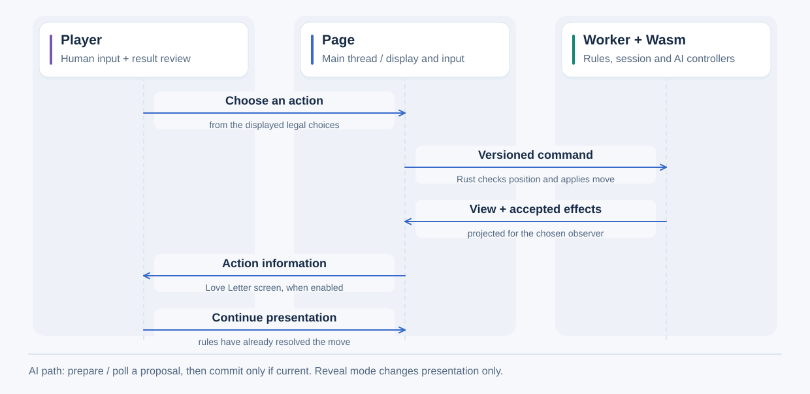

# Browser execution

A Web Worker owns the Wasm engine and sessions. The main page displays permitted
observations and submits versioned commands; rules stay in Rust.

## A browser move

The page and worker run on separate browser threads; the worker owns the Wasm
session. Rust validates the position before committing a move. The page then
presents permitted results. In Love Letter, an enabled action information screen
pauses presentation before the next decision; it does not delay rule resolution.
[Game-specific screen settings](../../guides/games/loveletter.md) decide when it appears.

For AI moves, `prepare_ai`/`poll_ai` calculate a proposal and `commit_ai` applies it
only if it is still current. Privileged reveal is a separate display choice and
does not change ordinary agent inputs. The [protocol](protocol.md) defines checks
and messages omitted from this overview.

A rule execution failure reports its original error and stops the live session.
Further move requests return `game_stopped`; reset or restore a valid recorded
position to continue. This is separate from a normal win, draw or loss. Invalid
action requests are rejected before rule effects and do not stop a healthy game.

- [Add a game or controller](integration.md)
- [Message protocol and limits](protocol.md)
- [Q-table and neural OSLA controllers](learned-controllers.md)
- [Neural MCTS model bindings](../learning/local-mcts.md)
- [Build and launch](../../../web/README.md)

[All reference sections](../README.md).
