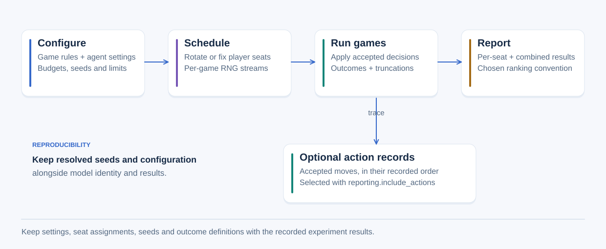

# Experiments

Match configuration selects one lineup. Tournaments compare an agent pool using
explicit schedules, seat assignments, seeds and scoring conventions.

## From settings to results

The schedule assigns seats and explicit RNG streams before games run. Reports
aggregate recorded outcomes using the chosen scoring convention. Optional action
records are selected with `reporting.include_actions` in match configuration. Separately,
`run_game_observed` can collect accepted-action traces through a callback; that
callback receives privileged state and controller access. It is not an acting
policy input. There is no general listener/metric registry or decorator layer.

- [Match configuration](matches.md)
- [Tournament configuration and reporting](tournaments.md)
- [Seeds, RNG streams and reproducibility](reproducibility.md)

[All reference sections](../README.md).
