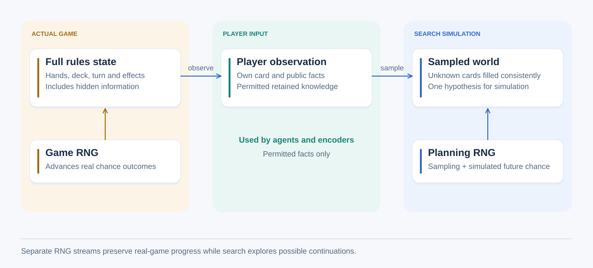

# State, information and execution contracts

These contracts explain what the framework's operations preserve. The
[overview](overview.md) lists supported capabilities; a guarantee about an
operation does not imply that every game or adapter implements that operation.

## State and exact snapshots

A state contains everything the rules need to continue: pieces/cards, phase,
active participant, unresolved effects, results and rule-relevant history.
Immutable rules/static content may be shared when their identity is recorded.
Stochastic continuation also requires the current environment RNG position or
explicit future chance events. Saving only a seed restarts a sequence.

An exact snapshot is independent: changing its mutable contents cannot change
its source. Immutable data may be shared. It preserves simulation data and any
simulation-owned RNG progress. A search fork deliberately uses separate future
randomness and is a different operation. In Rust, `Clone` invokes a type's copying
implementation; tests must establish that it meets these stronger semantics.

Equality is defined for a purpose. Exact-snapshot comparison includes rules and
RNG progress; a transposition key may deliberately omit some fields if its search
semantics justify that choice. Equal keys hash equally, but a matching hash is
not sufficient evidence that two states are equal.

## Actions, transitions and errors

Actions identify moves using owned values, coordinates or stable IDs. An action
from an observation or planning copy must still identify its intended move when
submitted to the authoritative state. It may be rejected if that state has changed
or if the action was legal only in a hypothetical world.

Rules own legality, automatic effects, phase/turn/round changes and termination.
Querying observations or actions must not advance authoritative progress or
environment randomness. Reject invalid external input without partially applying
the requested transition. Distinguish game errors and runner failures from
win/draw/loss outcomes; timeout penalties or substitutions are separate policies.

Apply validated actions directly to the supplied real or simulated state.
Internal execution failures, such as counter overflow or an inconsistent state,
must return a descriptive error and stop that execution. They may leave partial
effects; callers must discard a failed simulation or stop the real game, rather
than silently retrying it. Interactive sessions block further moves after a live
transition error until reset or reconstruction of a valid position. This is an
execution failure, not a normal game outcome. Ordinary invalid-action rejection
still happens before mutation. Search may copy or sample independent worlds to
explore alternatives; a forward model needs no additional full-state copy merely
to roll back rare internal failures.

The current sequential runner requires a nonempty action list for an acting
player. A forced pass is an explicit action. A terminal state has no next decision
maker even if it retains the last actor as metadata. Round elimination, temporary
inactivity and whole-game elimination have game-specific meanings.

## Observations and hypothetical states

This view illustrates Love Letter search. The game owns actual chance progress;
the agent owns planning randomness. Sampling receives the observation and planning
RNG. Its possible world is a simulation hypothesis, not access to the real hidden
cards. Other games have their own [simulation contracts](../games/README.md).

An observation contains the facts and retained knowledge its player is allowed
to have. This applies to cards, masks, IDs, text, history and metadata as well as
numeric arrays. Legitimate memory supplied by the rules is separate from an
agent's strategic beliefs.

Sampling fills unknown facts with hypotheses consistent with the observation and
game invariants. Its distribution and limits must be documented: a convenient
uniform sampler is not automatically the correct posterior distribution. Sampled
facts must never be encoded as known facts. Ordinary evaluator requests contain
only the relevant observer's information. Privileged research access is explicit
and separate from acting-time agent input.

Test information boundaries by varying inaccessible facts while holding the
permitted observation fixed. Observations, encodings, offered actions and masks
must remain unchanged. Test retained private knowledge and hypothetical opponent
views separately. Exact-state access through a read-only reference remains
privileged; immutability does not hide its contents.

Trusted execution obtains the acting player's choices directly from the full
state with `available_actions`, then passes only the action list and a separately
constructed observation to `Agent::choose`. This interface is identical for every
agent. Action generation must not use hidden facts to change the contents or order
of choices. For the same acting position, `offered_actions` from the permitted
observation must return the same list through shared game action-generation logic.
Browser display observations are constructed separately from agent decisions.

## Randomness and reproducibility

Keep environment chance, agent selection and simulation/belief randomness in
separately identified streams. Low-level operations receive explicit RNGs or
resolved seeds. User-facing setup accepts a fixed integer or resolves automatic
seeding once from operating-system randomness, then exposes the actual integer.
Do not substitute clock seeding.

Checkpoint resume preserves saved RNG progress rather than reseeding. Reproducing
search also requires fixed work limits, evaluator behaviour and execution order;
elapsed-time budgets do not guarantee identical trajectories. Equal Java/Rust
seeds do not establish matching games. Use controlled chance or recorded events
for behavioural comparisons. Cross-version/platform reproducibility needs explicit
version and implementation checks.

## Results, rewards and search values

Game score, rank, outcome, reward and estimated return are different quantities.
State whose perspective a value uses, its units and any discounting time step.
Multiplayer games may have shared winners and need not be zero-sum. Preserve
absolute player identity and complete value-vector meaning; never invent other
players' estimates by negating one value unless an explicit compatible two-player
contract permits that completion.

Experiments record rules, controller settings, seats, seeds, budgets and outputs.
Rotate seats by default in training/evaluation workflows, allow explicit fixed
seats and report per-seat and combined results. Truncating a run externally does
not create a game-defined winner or rank.

## Execution, files and platform boundaries

Interactive play and headless execution use the same transitions. Accepted live
actions are distinct from proposals, rejected commands, replay and search work.
Metrics define timing, units and access level. Logging sinks and live side effects
stay outside copied simulations. Search accounting distinguishes iterations,
transitions, copies and submitted/completed evaluations, including cancellation
and budget exhaustion.

Rules remain portable and independent of filesystem, graphics, Python and GPU
APIs. Adapters validate external commands/files and own buffer transfer. File
formats declare rule, action, controller, evaluator and RNG identities; unknown
versions fail explicitly. [Persistence](../persistence/recordings.md) describes
supported save/replay validation and exact-continuation limits.
