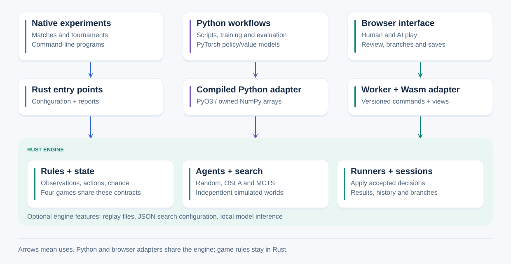

# Framework overview and capabilities

The framework separates game rules, action selection and execution. A game owns
the complete state and implements its forward model: initialization, observations,
available actions, transitions and results. An agent selects actions using the
information available to its player. A runner or interactive session applies
accepted choices through those same rules.

## Modules and execution boundaries

Arrows mean "uses". Python and the browser reach the engine through their compiled
adapters; game rules remain in Rust. This is a responsibility view, not a count of
processes. [Focused diagrams and reusable exports](../../images/architecture/README.md)
show decisions, information, evaluation and saved artifacts.

| Location | Responsibility |
|---|---|
| `src/core`, `src/games` | Shared contracts and native game rules |
| `src/agents`, `src/search/mcts` | Action selection, simulation and search accounting |
| `src/runner.rs`, `src/session` | Headless matches and versioned interactive decisions |
| `src/recording`, `src/replay` | Histories, branches, validated files and controller restoration |
| `src/learning`, optional `src/inference` | Numeric descriptions/encoding and local model evaluation |
| `examples/support/matches`, `examples/support/tournaments` | Experiment configuration, scheduling and reports |
| `adapters/python` | Compiled game/search operations, owned NumPy arrays and Python learning coordination |
| `adapters/browser`, `web` | Wasm protocol, worker execution, display, input and file controls |

The root workspace contains the engine and browser adapter. The Python adapter
has a separate workspace/lockfile and depends on the engine by path. Optional
`replay`, `mcts-json` and `inference` features keep file/configuration/model
dependencies separate from basic rules. Rules do not depend on Python, browser
APIs, rendering, filesystems or GPU runtimes.

## Supported workflows

| Capability | Tic-Tac-Toe | Connect 4 | Can't Stop | Love Letter |
|---|---|---|---|---|
| Players | 2 | 2 | 2-4 | 2-4 |
| Rules and native matches/tournaments | Yes | Yes | Yes | Yes, classic rules |
| Random and native lookahead/MCTS | Yes | Yes | Yes, independent sampled simulations | Yes, observation-derived sampled simulations |
| Python create/observe/apply/reset/copy | Yes | Yes | Yes | Yes, private observations |
| Python native/neural MCTS move calculation | Yes | Yes | Yes | Yes, model-input restrictions apply |
| Complete-game MCTS self-play and frozen-model evaluation | Yes | Yes | Yes | Yes, shared-win targets |
| Local neural agents in native match/tournament CLI | Yes | Yes | Not registered | Not registered |
| Learner-step Gym episodes and teacher/actor-critic workflow | Yes | Yes | Not registered | Not registered |
| Tabular Q-learning example | Default 3x3 game | Not supported by this example | Not supported by this example | Not supported by this example |
| Playable browser, history, branches and portable files | Yes | Yes | Yes | Yes, permitted and privileged views are separate |

Registration declares capabilities independently. Basic game operations do not
imply an encoder, heuristic, learner environment or replay codec. Models must match
the game's player count, rules, observation inputs, fixed action mapping and value
contract. See the [game contracts](../games/README.md) for details.

## Information and randomness

A complete state can contain hidden cards and environment RNG progress. An
observation contains only one player's permitted facts and retained knowledge.
Learning encoders and ordinary agents use observations. Love Letter sampling
constructs possible worlds from the observation; those worlds are hypotheses.

Exact snapshots preserve independent mutable state and RNG progress. Search forks
use an explicitly supplied simulation RNG. Agent choice, environment chance and
simulation randomness remain separate. User-facing workflows accept explicit or
automatic seeds and record the resolved integer. See [contracts](contracts.md)
and the [seed guide](../experiments/reproducibility.md).

## Python and browser execution

Python configures Rust games and search. Long suitable Rust operations release
the interpreter lock. Neural MCTS can suspend for a policy/value batch and resume
after Python evaluates it. Batching currently combines independent searches;
each tree has at most one pending request. Returned arrays have independent
owned storage; this is not a general zero-copy promise.

In the browser, a Web Worker owns the Wasm engine. The main page renders permitted
views and sends versioned commands. Search work and prepared proposals can become
obsolete after reset, replacement or branch changes; stale work must not commit.
Local model evaluation uses portable exported models, not Python/PyTorch running
inside the browser. [Python APIs](../python/README.md) and
[browser integration](../browser/README.md) explain these boundaries.

## Extension limits

`Decision` currently represents one acting player or completion. Simultaneous
submission, explicit standalone chance nodes and general team contracts require
additional design. Current MCTS requires its root choices to match the complete
legal set; arbitrary search filters are not a supported decorator mechanism.
There is no common listener/metric registry or passive agent lifecycle API.
Existing accepted-action callbacks and search reports support scoped research
without those facilities. The observed runner callback exposes full state and
controller data and must be treated as privileged.

IS-MCTS, remote player authentication/authority and a GPU inference backend are
not implemented. A new capability should be designed around an actual game,
experiment or deployment requirement. Java class structure is not an extension
requirement; preserve relevant behaviour and make semantic differences explicit.

The [workflow map](workflows.md) connects all supported execution and extension
modes to operating guides. [Native arguments](command-line.md) and
[Python flags](../python/command-line.md) provide exhaustive command options.
