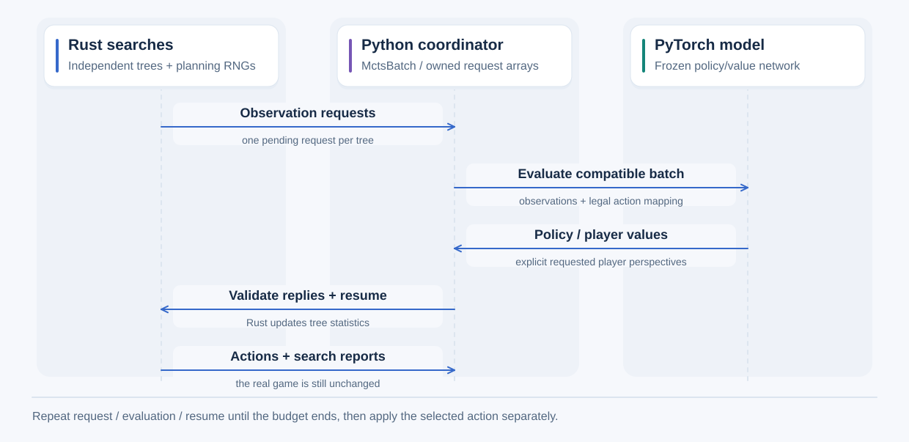

# Neural evaluation in Rust MCTS

For operating instructions, use [Run Rust MCTS from Python](../../guides/agents/rust-mcts-from-python.md). This page contains
the detailed reference.

MCTS explores simulated action sequences and uses their estimated player values
to update earlier choices. A policy/value network can supply state values and
PUCT action preferences. Simulation, tree traversal, selection, RNGs, budgets and
back-propagation run in Rust. Python groups observation rows from independent
searches and evaluates them with a frozen CPU PyTorch model.

The same search interfaces support Tic-Tac-Toe, Connect 4 and stochastic search
for Can't Stop and Love Letter with 2-4 players. Love Letter uses these
interfaces, with its own [information/value contract](../games/loveletter.md#python-native-and-neural-mcts).
Love Letter also supports [self-play](mcts-selfplay.md),
[opponent evaluation](model-evaluation.md) and [browser integration](../browser/integration.md). Can't Stop's stricter
[value/model contract](../games/cantstop.md#python-stochastic-mcts) and
[demonstration](../../guides/agents/rust-mcts-from-python.md#run-independent-searches)
cover the multiplayer case. Native Rust heuristics
remain available. These Python interfaces calculate individual moves and do not
attach a new game controller. [Local browser MCTS and neural match/tournament
configuration](local-mcts.md) are supported.
[Self-play collection and training](mcts-selfplay.md)
are supported.

## Run the example

Use the existing [Python setup](../python/setup.md) and optional
[PyTorch environment](neural-inference.md). After Rust changes, rebuild the adapter:

```powershell
$env:VIRTUAL_ENV = (Resolve-Path .venv).Path
.\.venv\Scripts\python.exe -m maturin develop --release --offline --manifest-path adapters/python/Cargo.toml
.\.venv\Scripts\python.exe adapters/python/examples/neural_mcts.py --game tictactoe --searches 4 --seed 42
.\.venv\Scripts\python.exe adapters/python/examples/neural_mcts.py --game connect4 --searches 4 --seed 42
```

The example uses [neural.json](../../../examples/mcts/neural.json), alternates
the root's acting seat, and reports every search's selected action, root visit
counts, mean player values, counters, effective settings and model identity.
It also measures total elapsed time, inference time and inference batch sizes.
The default model has randomly initialized weights; this checks execution and
does not establish playing strength. `--model path/to/model.json` instead loads
an existing portable evaluation model, validates its specification and freezes it.
Training checkpoint files are different: see [model files](neural-training.md).

`--game` accepts a registered Rust game ID. The script does not maintain a
separate list of game names. Discover this adapter's registrations with
`tag_rust.registered_games()`. A newly registered game still needs the observation,
action, evaluator and adapter capabilities used by neural search; discovery alone
does not implement them.

The example calculates independent move decisions; it does not train a model or
execute a tournament. Rust runs selection, expansion, rollouts, state copies,
native heuristics, budgets, terminal rewards, back-propagation and final action
selection. Rust also encodes permitted observations and validates external replies.
Python creates/loads the frozen model, coordinates request batches, packs neural
inputs, runs PyTorch inference, maps its outputs to requested players/actions,
and prints measurements. Python does not perform simulated game transitions.

## Configure and calculate a move

The MCTS JSON schema is unchanged. Select two distinct external evaluator names:

```json
{
  "schema_version": 1,
  "seed": null,
  "tree_policy": "puct",
  "rollout_length": 0,
  "budgets": {"iterations": 64},
  "state_evaluator": {"name": "network_value"},
  "puct_preferences": {
    "source": "probabilities",
    "evaluator": {"name": "network_policy"}
  },
  "value_completion": "require_full_vector"
}
```

Application code binds these names to an evaluator; the core never opens model
files or imports Python classes. External names take empty core `parameters`.
Model weights, observation restrictions and model-specific settings belong to
the Python evaluator. A full example using a saved model is:

```python
import tag_rust as tag
from tag_rust.learning.artifacts import load_model
from tag_rust.learning.snapshot import FrozenModel
from tag_rust.search.neural_mcts import NeuralMctsEvaluator

snapshot = FrozenModel(load_model("model.json"))
evaluator = NeuralMctsEvaluator(snapshot)
with tag.create("tictactoe") as game:
    with tag.MctsSearch(game, "examples/mcts/neural.json", bindings={
        "network_value": evaluator, "network_policy": evaluator
    }) as search:
        with tag.MctsBatch([search]) as batch:
            report, = batch.run()
            if batch.errors:
                raise RuntimeError(batch.errors)
        game.apply(report["action_id"], position=search.position)
```

Search does not apply its recommendation. The final line applies it through
the existing position-checked game API. A move, reset, controller replacement
or closing the source game invalidates its captured position for further search
operations. Changing the real game never changes the retained simulation.

`MctsSearch` accepts a JSON file path, JSON text or mapping. Its resolved
`settings["seed"]` is the actual integer selected by Rust. Null/omitted seeds
use OS randomness. Each search creates a fresh agent and tree; reuse an explicit
seed to compare fixed-work decisions from the same position. Separate calls do
not persist external agent RNG progress between separate decisions.

Omit `bindings` and use an ordinary native configuration to perform entirely
Rust-evaluated MCTS through the same interface. State evaluation and PUCT
preferences can independently be native or external. Progressive bias, expansion
ordering and rollout action heuristics remain native. A rollout
length of zero evaluates the expanded leaf, while the tree-depth boundary skips
rollouts and immediately evaluates the selected node, as in native search.

## Player values and model compatibility

Every completed iteration back-propagates a value for each absolute player ID.
The design must explicitly define how those estimates supply the required player
values for multiplayer games. The selected `value_completion` rule remains:

- `require_full_vector`: reject a scalar that has not supplied every player's value.
- `fill_zeros`: keep the identified player's scalar; set every other player to zero.
- `negation`: keep the identified player's scalar; set every other player to its negation.

Complete vectors pass unchanged through every completion policy. Synthetic values
are modeling assumptions; they do not establish zero-sum or multiplayer game rules.

`value_observers`, a Python binding setting, selects observations for value requests:

| Value | Meaning |
|---|---|
| `all_players` (placement-game default) | Encode the same simulated position once per player. A compatible scalar observer model predicts each row's value, which the evaluator assembles into a complete vector. |
| `root_player` | Observe the current simulated position from the real decision maker's perspective. A scalar uses that explicit player ID and the completion rule. |
| `deciding_player` | Observe from the player who acts next in that simulated position. A scalar uses that player ID and the completion rule. |

Omitted/None `value_observers` selects `deciding_player` for Can't Stop and
`all_players` for the placement games. Can't Stop external values require full
vectors, strict completion and deciding-player observations.

A full-vector model declares its output player order; the adapter reorders it into
absolute player order. It can use one observation with `root_player` or
`deciding_player`. An incomplete declared vector is rejected. A scalar model with
strict completion requires `all_players`. Terminal rewards come directly from
the game and bypass the model and value-completion assumptions.

PUCT policy requests always use the node's deciding player. The evaluator applies
the existing legal-action mask, then returns probabilities in the exact requested
action order. Zero legal probability mass, negative/nonfinite values and incorrect
IDs or shapes are errors. Rust normalizes positive legal mass. State-value and
policy requests may refer to different positions when a rollout follows expansion.
They are not automatically interchangeable outputs from one network call.

`NeuralMctsEvaluator` checks the game, parameters, encoding and action specification.
It checks named tensor specifications and currently requires the terminal value
units `win=1,draw=0,loss=-1`. It supports fixed action IDs for the current games. Candidate-feature policies
need a future candidate encoder. `supported_observers` declares permitted player
IDs; `turn_context="own_turn"` restricts observations to their acting player,
whereas the default `"any_turn"` permits non-acting observers. All-player scalar
evaluation requires every observer and non-acting contexts. Unsupported inputs
are rejected. These declarations describe compatibility, not prediction accuracy
on contexts absent from the model's training data. Existing model reward units
and discount conventions remain part of its frozen identity; search does not
retrain or reinterpret its predictions as proven game outcomes.

## Advance, evaluate and resume



Time runs downward; the request/evaluation/resume loop repeats until search ends.
Python and the compiled Rust adapter run in the same process. Each Rust tree owns
its simulation and planning RNG, with at most one pending request. Python batches
across independent trees; request arrays have owned storage. The PyTorch model
supplies estimates while Rust performs simulated transitions and back-propagation.
The two output types are shown together for brevity; each request names its kind.

For custom evaluators or explicit scheduling, use `search.advance()` and
`search.resume(request, response)`. Advance returns a `MctsRequest`, a completed
report, or `None` after one completed iteration yields control. A request contains
its search/sequence ID, kind (`values` or `policy`), evaluator identity, explicit
player perspectives, owned observations and the policy's ordered legal action IDs.
The observations' position token identifies the captured real root; their numeric
arrays and progress describe the simulated evaluation position.

Create a `MctsResponse` with `MctsResponse.for_request(request, values,
scalar_player=...)`. Values must be finite float64 vectors. Full value vectors
use absolute player order. A scalar must identify the single requested observer;
policy responses must preserve the requested action order. Malformed replies
leave the request available for correction. Duplicate, foreign, stale and changed
model identities are rejected before back-propagation or RNG continuation.

A custom external evaluator supplies:

- `identity`: a stable, nonempty string identifying its implementation/settings.
- `payloads`: the names of observation arrays it needs.
- `validate(spec, kind, value_observers, completion)`: check compatibility before search.
- `evaluate(requests, max_bytes=...)`: return one `MctsResponse` per request in order.

`MctsBatch.advance()` visits each unfinished search and returns compatible
`MctsGroup` objects. A group's members retain their search indices and requests.
Call its evaluator, then `batch.resume(group, responses)`. Every response is
validated before any member resumes. Runtime errors after that validation are
recorded per search in `batch.errors`; successful peers retain their results.
`batch.run()` performs this loop and returns reports, with `None` for failed
members. Inference errors propagate so callers can correct or retry pending work.

## Budgets, ownership and execution limits

The decision timer starts on its first advance before root reconstruction.
It includes encoding, Python scheduling, inference and waits. Advance/resume
checks elapsed time, including while waiting: late predictions add no visits.
No background deadline timer runs. Poll advance if results will not arrive.
Time expiry discards an unfinished iteration and its staged edge. At the
forward-model limit, the current iteration may still request its final value
and finish back-propagation, but it cannot apply another simulated action.
Cancellation takes precedence and returns no recommendation. Synchronous native
evaluators and PyTorch inference cannot be forcibly interrupted.

`MctsBatch` defaults to at most 64 associated searches, 4096 rows per group and
64 MiB of numeric request arrays per group. Search has its own row/byte limits;
its byte limit also respects JSON `limits.max_request_bytes` and the game encoding
limit. Groups split without changing a tree's statistics. A single request too
large to fit is rejected rather than dropping player perspectives. These limits
do not bound model-private allocations, all Python copies or total process memory.
Callers can create independent searches outside a coordinator; its search-count
limit does not impose a global thread cap.

Arrays transferred to Python own their storage; retaining or changing them cannot
alter the real game or simulation. Packing observations for inference makes
additional owned arrays. This is CPU inference, with no zero-copy or GPU claim.

In Rust, `search_controlled_async` returns a future: the compiler retains local
search data while it waits, much as an explicit suspended-method state machine
would in Java/C++. Its exclusive agent borrow prevents concurrent changes to that
agent. `ExternalEvaluations` transfers observations and validates replies. Native
`search` drives the same implementation synchronously; an external binding used
through ordinary `Agent::choose` returns `EvaluationRequired`. Native snapshots
remain supported; external evaluator checkpointing is explicitly unsupported.

The Python adapter constructs and polls each future on one native worker thread.
This preserves existing thread-local evaluator implementations without unsafe
cross-thread transfers or a new async runtime dependency. The coordinator visits
workers sequentially and releases Python's interpreter lock during Rust work;
this is not a parallel-search speed claim. Closing/cancelling a search invalidates
its pending work and releases its continuation. Closing a batch closes its member
searches. The core search creates no threads and still compiles for WebAssembly.

See [local MCTS](local-mcts.md) for native/browser model bindings and
[self-play](mcts-selfplay.md) for complete-game training.
