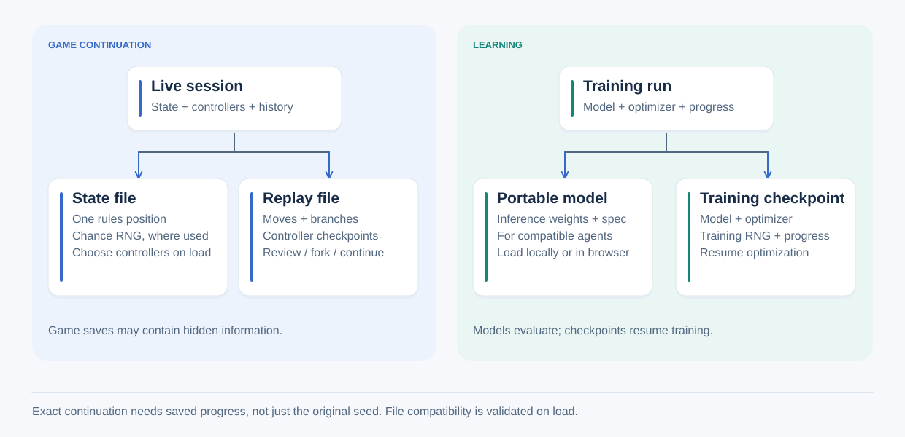

# Saved states and recordings

A saved state resumes the rules from one position. A recording also retains
actions and controller checkpoints for review, exact continuation and branches.

## Choose the file for the task

A state file restores one rules position; a replay also retains the recorded
history and controller checkpoints needed for review and continuation. These
files may contain hidden information. A portable model supplies inference weights;
a training checkpoint additionally retains optimization and training RNG progress.
It cannot be used as a browser model. See [game file formats](formats.md) and
[training artifacts](../learning/neural-training.md) for the distinct contracts.

- [Implement and validate persistence](recordings.md)
- [Browser save/load operations](../../guides/running/browser.md)

[All reference sections](../README.md).
