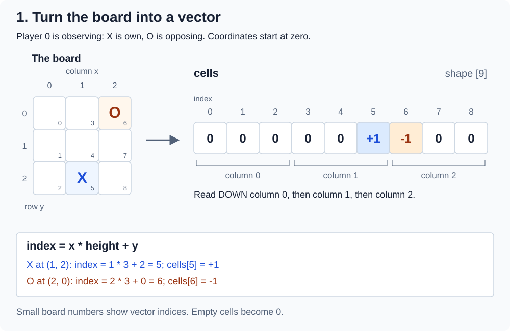
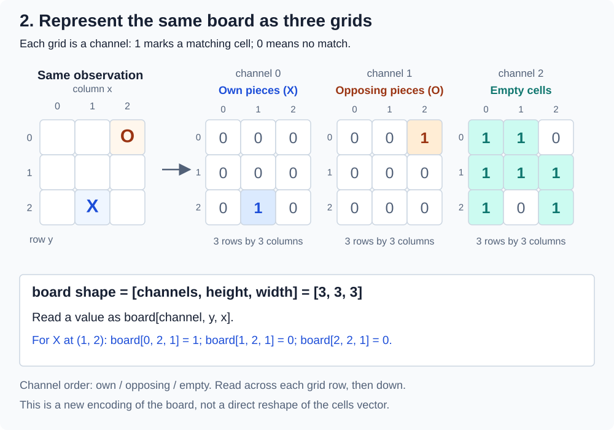

# How the framework works

This introduction follows a move through the rules, agents and execution layers,
then explains learning inputs, search and saved games. Follow the links for
implementation details and the [capability overview](reference/framework/overview.md)
for supported game/workflow combinations.

## Contents

- [Follow one move](#follow-one-move)
- [Understand the current agents](#understand-the-current-agents)
- [Read the learning-input code](#read-the-learning-input-code)
- [Understand learning and search](#understand-learning-and-search)
- [Review and save games](#review-and-save-games)
- [Choose a reading path](#choose-a-reading-path)

## Follow one move

Imagine a game of Tic-Tac-Toe. The board is empty and Player 0 is about to act.

1. The **game state** stores the board, whose turn it is, how many moves have been
   made, and whether the game has ended. It contains everything the rules need to
   continue the game.
2. The **forward model** implements the rules. It creates the initial state, lists
   available actions and applies an action to a state. A simulated transition uses
   the same rules as a move in the real game.
3. The game creates an **observation** for Player 0: the information that player
   is allowed to see. In Tic-Tac-Toe this includes the whole board. In Love Letter
   it includes the player's own hand but not an opponent's cards.
4. An **agent** is a program that chooses a move for a player. It receives the
   observation and a list of actions it can choose from. RandomAgent selects one
   list entry at random. A human supplies a choice through the interface instead.
5. The **runner** or **session** checks the choice and asks the forward model to
   apply it. If Player 0 chose the center, the board now contains an X there.
6. The rules check for a win or draw. If play continues, Player 1 acts next.

The game rules decide what a move does. The agent decides which move to try.
The browser displays the result; it does not contain a second implementation of
the Tic-Tac-Toe rules.

## Understand the current agents

**First Available** chooses the first action in the list. It is useful for testing
that complete games can run. **Random** gives every available list entry an equal
chance of selection.

**OSLA** means *one-step lookahead*. For each available action, it copies the
current state, applies that action to the copy, and gives the resulting position
a numerical estimate. An **evaluator** is the function that computes that estimate.
A hand-written evaluator is often called a **heuristic**. For example, an open
line containing two friendly pieces may be more promising than an empty line.
The evaluator's formula determines the meaning and scale of its estimates. Our
placement-game evaluators score promising open lines; game scores come from the rules.

OSLA chooses a move with an estimate close to the highest one. It uses its own
random-number generator to choose between qualifying moves. A **seed** sets the
starting point of that generator. Saving its current position as well as its seed
lets a restored agent make the same future random choices. The saved information
is called an **agent checkpoint**.

For Can't Stop and Love Letter, **sampled OSLA** averages estimates from several
independent simulated successors per action. Simulation starts from the player's
permitted information and uses its own randomness. Love Letter's unknown cards
are sampled hypotheses, rather than facts about the real opponent's hand.

The separate **OSLAPython** agent prepares positions in Rust and asks Python to
evaluate several together. A group evaluated together is a **batch**. Rust checks
the returned values and selects a move; a commit call applies it and updates the
live agent's RNG. The [OSLAPython guide](reference/python/external-osla.md) explains
the implemented flow, including a Python version of the native heuristic and
measurements of simulation, encoding and evaluation costs.

## Read the learning-input code

A neural network usually expects arrays of numbers rather than Rust game objects.
An **encoding** specifies how to turn the player's observation into those arrays.
A **tensor** is an array that may have one or more dimensions. A vector of nine
cell values has shape `[9]`; an image might have height, width and color dimensions.

The current learning code can represent a board in two ways:

- `cells` is a vector: own pieces are +1, opposing pieces -1, and empty cells 0.
- `board` is a grid with three channels. One marks own pieces, one marks opposing
  pieces, and one marks empty cells. Its shape is `[3, height, width]`.

The following figures show the **same board from Player 0's viewpoint**. Player 0
uses X and Player 1 uses O. The position is deliberately asymmetric, so reading
cells in the wrong order would give a different result.

For the `cells` vector, read **down the first column**, then down the second,
then the third. This is called **x-major order**: `index = x * height + y`.
Coordinates start at zero. X at `(1,2)` becomes entry 5 with value +1; O at `(2,0)`
becomes entry 6 with value -1. A vector has one dimension, so its shape is `[9]`.

For `board`, each channel answers one question: **is this cell mine, opposing, or
empty?** Each channel therefore contains only 0 and 1. Stack the three grids to
make one tensor with shape `[3,3,3]`: three channels, three rows, three columns.
The value at `board[0,2,1]` is 1 because channel 0 marks own pieces and X occupies
row 2, column 1. These are conceptual array coordinates; the Rust value stores
the numbers in a flat vector together with its shape.

The two representations use different arrangements of numbers. Turning `cells`
into `board` requires creating three channels and arranging each channel in
row-by-row order. For a standard Connect 4 board, the same three-channel
convention has shape `[3,6,7]`. If Player 1 observes instead, the own/opposing
channels swap, and the signs in `cells` reverse; empty cells stay empty.

A **description** (`LearningSpec`) says which arrays are available and explains
their shapes and meanings. The **encoded observation** (`EncodedObservation`)
contains the actual numbers for one position. A requested group of data is also
called a **payload** in the code. For example, asking for `image` currently fails
because no image encoder has been implemented for these games.

The code also assigns an **action ID** to every representable move. For Connect 4,
IDs 0 through 6 refer to the seven columns. A **legal-action mask** is a list of
true/false values saying which IDs are currently available. If column 0 is full,
its mask entry becomes false; column 1 keeps ID 1. IDs are not renumbered whenever
the list of legal actions changes. This matters when a network has one output per ID.

The [learning-input guide](reference/learning/overview.md) walks through an actual encoded
position and explains the file and function names.

## Understand learning and search

A **policy** says how an agent chooses actions, often by giving each action a
probability. A **value function** estimates the future reward from a position.
A neural network (**NN**) can learn either or both from examples.

In **reinforcement learning (RL)**, an agent learns from actions and rewards over
games or episodes. An **episode** runs from an initial situation to an ending
condition. A Gym-style interface provides `reset()` to start an episode and
`step(action)` to apply a choice and receive the next observation and reward.
For a multiplayer game we must specify whose observation and reward are returned.
The [learner environment](reference/python/gym-episodes.md) returns a fixed
learner's observations and rewards. [The Q-learning example](reference/learning/tabular-learning.md)
collects these transitions and updates a table of action values.

**Monte Carlo tree search (MCTS)** considers sequences of possible moves, organizing
them in a tree. Repeated simulations help it decide which moves deserve more
attention. AlphaGo-style systems combine search with learned policy/value estimates.
The [native MCTS agent](reference/agents/mcts-api.md) implements open-loop search with native
Rust state and action heuristics. [Neural MCTS](reference/learning/neural-mcts.md)
connects it to batched policy/value evaluation. The implemented [match runner](reference/experiments/matches.md) lets you
select opponents and compare different native agent configurations.
[Neural training](reference/learning/neural-training.md)
already supports imitation learning from OSLA and actor-critic learning.

## Review and save games

A **recording** stores accepted moves. Reviewing it lets you inspect earlier
positions without changing the live game or advancing its agents' random numbers.
A **branch** is an alternative continuation: you can return to an earlier position,
try another move or controller, and retain the original continuation too.

The browser can save a whole session, one branch, or only the displayed state.
Saving a state at move 8 preserves that position but not the earlier moves you
would need for Previous/Next navigation. A replay file preserves move records and
the agent information needed to continue. [The save/load guide](reference/persistence/recordings.md)
explains these differences and the checks performed when a file is loaded.

## Choose a reading path

Start with the [Rust reading guide](reference/framework/rust-for-java-cpp.md) if `&`, `impl`, `Result`
or associated types are unfamiliar. Then follow the [new-game](reference/framework/implementing-games.md)
or [new-agent](reference/agents/implementing-agents.md) guide for your project. You can run the native
examples before studying browser message handling or file compatibility.

Keep [the glossary](reference/framework/glossary.md) nearby for additional terms.
The [framework overview](reference/framework/overview.md) explains module ownership,
capabilities and extension limits. Use the [reference index](reference/README.md)
to look up complete API and configuration details.
